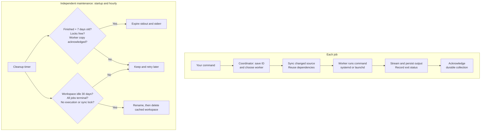

`relay-job` runs tests, builds, and other batch commands on persistent Linux and macOS workers. It keeps dependencies and build caches warm, transfers changed source files, and gives callers durable job IDs, original output, and the command's exit status.

# What It Does

- **Reuse remote workspaces:** Synchronize dirty and untracked source, deletions, and file modes while preserving configured dependency directories.
- **Schedule across workers:** Select by worker name, operating-system label, required tools, warmth, and free slots.
- **Recover execution:** Reconnect after a lost reply or daemon restart using the same worker and job ID.
- **Configure with TOML:** Define workers and service settings in user configuration, and reusable commands in project configuration.
- **Retain safely:** Expire old collected logs and unused workspaces while keeping active work and duplicate-execution protection.

# How It Works

- Install the binary on the submitting machine and every worker.
- Start a worker agent on each execution machine, and a coordinator on the submitting machine.
- Add worker SSH aliases, absolute socket paths, and optional labels to the coordinator's TOML file.
- Run `relay-job job exec -- <command...>` or define named jobs in `relay-job.toml` and run `relay-job job run <name>`.
- Follow output to completion, or submit with `--detach` and reconnect later.



# How it Really Works

- The CLI is short-lived. Coordinator and worker agents remain running. The coordinator reaches private worker Unix sockets through reusable [OpenSSH](https://www.openssh.com/) connections; workers expose no TCP listener.
- Each canonical source directory gets its own workspace. [Rsync](https://www.samba.org/ftp/rsync/rsync.1) checksums both copies and transfers changed data. Checksumming still reads unchanged files. `.git/` is excluded automatically; specify dependency/cache exclusions explicitly.
- Linux uses native systemd user execution units; macOS uses launchd jobs. Agent or coordinator restarts preserve independent execution. An ambiguous start reply is reconciled on its assigned worker, without replaying elsewhere.
- Busy eligible workers queue jobs. With all eligible workers offline, the default is an explicit failure. `--unavailable local` opts into running the original checkout before remote submission. Configuration errors, source-sync failures, and command failures never trigger fallback.
- Command stdout/stderr stay separate original byte streams, with no cross-stream ordering guarantee. The generated job ID and CLI diagnostics go to stderr. `--quiet` omits the ID prefix. `AGENT=1` selects compact help and diagnostics, while command bytes remain unchanged.
- Exit status matches the command. Cancellation returns 130; infrastructure failure or lost execution returns 125; CLI/API errors return 1. A missing execution unit without a completion receipt is reported as lost and is not replayed.
- State and mirrored logs live under `$XDG_STATE_HOME/relay-job` and workspaces under `$XDG_CACHE_HOME/relay-job`. Without overrides, worker agents use separate `relay-job-worker` directories. Bases default to `~/.local/state` and `~/.cache`.
- Maintenance runs at startup and hourly: completed logs expire after seven days; tracked idle workspaces after thirty days. Worker logs require durable collection acknowledgment. Receipts, execution markers, and lock files stay indefinitely. Expired log requests fail explicitly with HTTP 410. Workspace deletion includes excluded dependencies inside it; bootstrap them again on the next job.
- Jobs execute with the worker account's permissions and explicitly configured job environment. They are trusted workloads, without a sandbox, TTY, or interactive stdin. Keep source files stable during sync; reads are not a filesystem snapshot.

# Installation

Download the versioned archive for your operating system and CPU from the [latest release](https://github.com/alexgorbatchev/relay-job-cli/releases/latest). For an Apple silicon Mac:

```sh
curl -fLO https://github.com/alexgorbatchev/relay-job-cli/releases/download/v0.1.0/relay-job_0.1.0_darwin_arm64.tar.gz
tar -xzf relay-job_0.1.0_darwin_arm64.tar.gz
mkdir -p "$HOME/.local/bin"
install -m 755 relay-job "$HOME/.local/bin/relay-job"
```

Add `~/.local/bin` to PATH. Releases include Linux and macOS archives for amd64 and arm64, example configurations, and `checksums.txt`.

# Setup

- Configure SSH aliases, existing authentication, and trusted host keys for remote workers. An omitted worker `host` selects a local Unix socket.
- Install rsync with protected-argument support on machines that synchronize source. Install each job's runtime and dependencies on its workers; the CLI binary itself does not require Go.
- Linux execution requires a running [systemd user manager](https://www.freedesktop.org/software/systemd/man/latest/systemd-run.html). Run `relay-job service install --role worker` on workers and `relay-job service install --role coordinator` on the submitting machine. The installer starts the service; restart an already active service after reinstalling its binary. Configure lingering separately when services must survive logout.
- macOS execution requires the native [launchd](https://developer.apple.com/library/archive/documentation/MacOSX/Conceptual/BPSystemStartup/Chapters/CreatingLaunchdJobs.html) user domain and `plutil`. Run `relay-job worker serve`, or adapt [the LaunchAgent example](examples/launchd-worker.plist) with the absolute binary path and required tool PATH, save it as `~/Library/LaunchAgents/com.relay-job.worker.plist`, and load it with `launchctl bootstrap "gui/$(id -u)" "$HOME/Library/LaunchAgents/com.relay-job.worker.plist"`. This example starts at GUI login; it does not provision a system boot daemon. `service install` is Linux-only.
- Different daemon instances need distinct state, cache, and socket paths. For mixed operating systems, select a worker or OS label and exclude host-built dependencies before synchronization.

# Quick Start

On a worker, write `~/.config/relay-job/config.toml`:

```toml
[worker]
slots = 2

[retention]
logs = "168h"
workspaces = "720h"
interval = "1h"
```

Start it with `relay-job worker serve`, or install the Linux worker service described above. Its default socket is `~/.local/state/relay-job-worker/worker.sock`.

On the submitting machine, write `~/.config/relay-job/config.toml`, replacing the SSH alias and worker account's absolute socket path:

```toml
[[workers]]
name = "linux"
host = "build-worker"
socket = "/home/runner/.local/state/relay-job-worker/worker.sock"
labels = ["linux", "amd64"]
```

Start the coordinator in one terminal with `relay-job coordinator serve`, or install its Linux service. Then:

```sh
relay-job worker list
relay-job job exec --workers linux -- printf 'remote hello\n'
```

Sample Output:

```text
job: 2124b1dc1116b9c466c94dee8c67560f
remote hello
```

Define a project `relay-job.toml`:

```toml
[jobs.test]
command = ["just", "test-local"]
workers = ["linux"]
requires = ["just"]
exclude = ["node_modules/", ".venv/", "bin/", ".tmp/"]
unavailable = "fail"

[jobs.test.env]
TEST_MODE = "integration"
```

Run `relay-job job run test`. The example uses a project's existing `just test-local` recipe; any executable and literal argument array is supported. Keep local commands separate from a remote wrapper to avoid recursion. Bootstrap excluded dependency directories from lockfiles with an ordinary remote job before testing.

# Options & Flags

Global flags:

| Flag | Short | Default | Description |
| :--- | :--- | :--- | :--- |
| `--config <path>` | — | `~/.config/relay-job/config.toml` | Strict TOML user config; honors XDG_CONFIG_HOME |
| `--state <path>` | — | `~/.local/state/relay-job` | Durable state; worker default is `relay-job-worker` |
| `--cache <path>` | — | `~/.cache/relay-job` | Workspace cache; worker default is `relay-job-worker` |
| `--socket <path>` | — | `<effective-state>/coordinator.sock` | Worker default is `<effective-state>/worker.sock` |
| `--help` | `-h` | `false` | Command help |
| `--version` | `-v` | `false` | Raw version and newline |

CLI flags override TOML. Missing default configuration is optional for commands that do not need a worker list; an explicitly selected missing file fails. Unknown TOML keys fail. Relative TOML paths resolve from the configuration file and expand a leading `~`; CLI paths resolve from the caller's directory.

`relay-job job exec -- <command...>` and `relay-job job run <name>`:

| Flag | Short | Default | Description |
| :--- | :--- | :--- | :--- |
| `--source <path>` | — | `.` | Source directory, including dirty and untracked files |
| `--project <file>` | — | `relay-job.toml` | Named-job TOML relative to source |
| `--id <id>` | — | empty | Reuse a generated ID with the identical request |
| `--unavailable <policy>` | — | `fail` | `fail` or explicit `local` before submission |
| `--detach` | — | `false` | Submit without following output |
| `--quiet` | — | `false` | Omit the generated ID prefix on stderr |
| `--workers <names>` | — | `[]` | Comma-separated eligible worker names |
| `--exclude <patterns>` | — | `[]` | Rsync exclusions protected from deletion |
| `--requires <tools>` | — | `[]` | Required worker executables |
| `--labels <labels>` | — | `[]` | Required worker labels |
| `--env <KEY=VALUE>` | — | `[]` | Repeat for explicit command environment |

`relay-job job logs <id>`:

| Flag | Short | Default | Description |
| :--- | :--- | :--- | :--- |
| `--follow` | — | `false` | Follow output and return command exit status |

`relay-job worker serve`:

| Flag | Short | Default | Description |
| :--- | :--- | :--- | :--- |
| `--slots <count>` | — | `1` | Positive simultaneous reservation/execution limit |

`relay-job worker serve`, `relay-job coordinator serve`, and `relay-job service install`:

| Flag | Short | Default | Description |
| :--- | :--- | :--- | :--- |
| `--log-retention <duration>` | — | `168h0m0s` | Completed-log lifetime; `0` disables expiry |
| `--workspace-retention <duration>` | — | `720h0m0s` | Idle workspace lifetime; `0` disables expiry |
| `--cleanup-interval <duration>` | — | `1h0m0s` | Positive maintenance interval |

`relay-job service install`:

| Flag | Short | Default | Description |
| :--- | :--- | :--- | :--- |
| `--role <role>` | — | empty | Required: `worker` or `coordinator` |
| `--slots <count>` | — | `1` | Positive worker concurrency limit |
| `--name <unit.service>` | — | empty | Runtime default `relay-job-<role>.service` |
| `--binary <path>` | — | empty | Runtime default: the running executable |

The installer copies the binary to `$XDG_DATA_HOME/relay-job/bin/relay-job` and captures PATH. On restart, services reread TOML; explicit installation flags remain overrides. User units go under `$XDG_CONFIG_HOME/systemd/user`. Bases default to `~/.local/share` and `~/.config`.

# TOML Configuration

The complete [user example](examples/config.toml) configures workers, slots and retention. Optional local daemon paths:

```toml
[paths]
state = "state"
cache = "cache"
socket = "coordinator.sock"
```

Those relative paths resolve beside the config file. A custom state path also determines the default socket when `paths.socket` and `--socket` are absent. Use distinct files or overrides when hosting a worker and coordinator on the same machine.

Retention uses Go duration strings such as `24h` or `30m`, not `7d`. Periods must be nonnegative; interval must be positive. Named project jobs support `command`, `cwd`, `env`, `exclude`, `requires`, `workers`, `labels`, and `unavailable`. `cwd` must stay inside the source directory. CLI overrides replace the corresponding project settings.

# Recovery

Keep the printed job ID. Query `relay-job job status <id>`, replay `relay-job job logs <id>`, or reconnect with `relay-job job logs <id> --follow`. Cancel with `relay-job job cancel <id>`. SIGINT/SIGTERM/SIGHUP while following requests cancellation. An unreachable worker leaves cancellation pending until recovery; do not submit another copy merely because a reply was lost.

The [agent usage skill](skills/relay-job/SKILL.md) covers the full command interface. `relay-job skill` prints its installation command and URL offline.

# License

[MIT](LICENSE), copyright Alex Gorbatchev.
